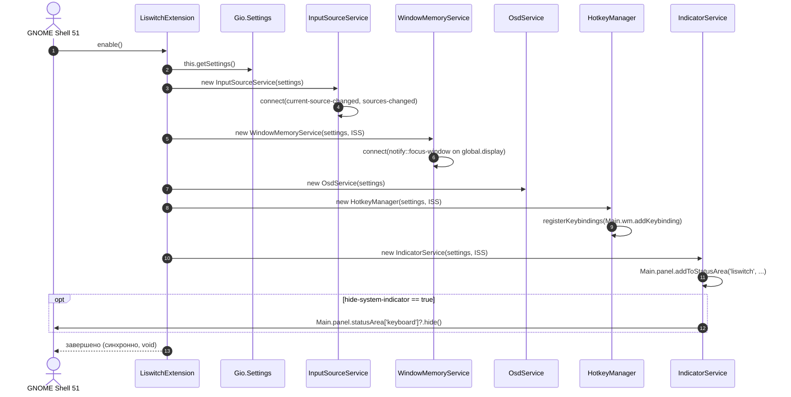
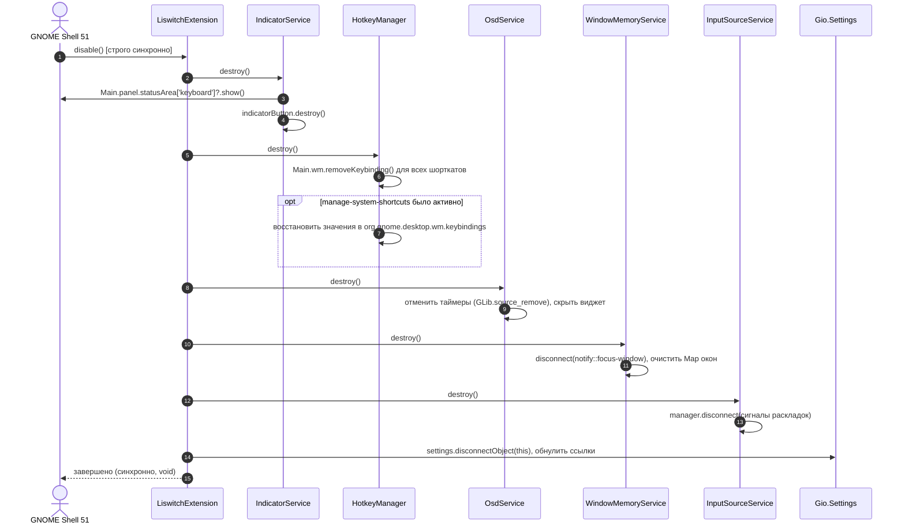

# Архитектура расширения liswitch

- **Идентификатор расширения (UUID)**: `liswitch@local`
- **Целевая платформа**: GNOME Shell 51 (GJS 1.90, Mutter 51, только сессия Wayland)
- **Версия документа**: 1.0 (Этап 2)
- **Статус**: Утверждена для реализации

---

## 1. Дерево файлов проекта

Проект организован по модульному принципу в виде стандартных ES-модулей (ESM) без монолитного файла `extension.js`:

```
liswitch/
├── metadata.json                        # Манифест расширения (UUID, версии Shell, зависимости)
├── extension.js                         # Главный класс Extension: точка входа, координация enable/disable
├── prefs.js                             # Главный класс ExtensionPreferences: построение UI Libadwaita
├── stylesheet.css                       # Стили для OSD-уведомления и индикатора панели
├── schemas/
│   └── org.gnome.shell.extensions.liswitch.gschema.xml  # Схема GSettings с описанием параметров
├── src/
│   ├── constants.js                     # Константы, перечисления (режимы памяти, форматы)
│   ├── inputSourceService.js            # Сервис-адаптер для взаимодействия с InputSourceManager
│   ├── windowMemoryService.js           # Сервис отслеживания окон/приложений и запоминания раскладки
│   ├── hotkeyManager.js                 # Менеджер регистрации и разрешения конфликтов горячих клавиш
│   ├── indicatorService.js              # Виджет индикатора в верхней панели и меню (PanelMenu.Button)
│   ├── osdService.js                    # Визуальный OSD-оверлей при переключении раскладок
│   └── utils.js                         # Вспомогательные функции (нормализация имен, поиск окон)
├── locale/                              # Файлы локализации Gettext (po / mo)
│   ├── ru/LC_MESSAGES/liswitch.po
│   └── liswitch.pot
├── tests/
│   ├── smoke-test.js                    # Автоматизированный headless-тест для gnome-shell-test-tool
│   └── memory-test.js                   # Тест корректности восстановления раскладки окон
└── docs/
    ├── PROGRESS.md                      # Долгосрочный журнал этапов разработки
    ├── api-notes.md                     # Аудированный справочник по API GNOME Shell 51
    ├── spec.md                          # Спецификация функциональности (MVP)
    └── architecture.md                  # Настоящий архитектурный документ
```

---

## 2. Схема GSettings (`schemas/org.gnome.shell.extensions.liswitch.gschema.xml`)

Расширение использует выделенный путь настроек `/org/gnome/shell/extensions/liswitch/`.

```xml
<?xml version="1.0" encoding="UTF-8"?>
<schemalist gettext-domain="liswitch">
  <schema id="org.gnome.shell.extensions.liswitch" path="/org/gnome/shell/extensions/liswitch/">

    <!-- === Индикатор панели === -->
    <key name="indicator-enabled" type="b">
      <default>true</default>
      <summary>Show indicator in top panel</summary>
      <description>Whether to show the language indicator button in the GNOME Shell top panel.</description>
    </key>

    <key name="hide-system-indicator" type="b">
      <default>true</default>
      <summary>Hide default system keyboard indicator</summary>
      <description>Whether to hide the default GNOME Shell keyboard indicator to prevent duplicates.</description>
    </key>

    <key name="indicator-format" type="s">
      <default>'uppercase'</default>
      <summary>Format of the layout text in the panel</summary>
      <description>Display format for the current layout code: 'uppercase' (EN, RU), 'lowercase' (en, ru), 'full' (en-intl).</description>
    </key>

    <!-- === Память раскладок для окон/приложений === -->
    <key name="memory-mode" type="s">
      <default>'app'</default>
      <summary>Layout memory persistence mode</summary>
      <description>Mode of remembering layouts: 'none' (disabled), 'app' (per application), 'window' (per individual window).</description>
    </key>

    <key name="default-layout-mode" type="s">
      <default>'keep'</default>
      <summary>Default layout for new windows</summary>
      <description>Action for newly focused windows without prior history: 'keep' (preserve active layout), 'first' (reset to first configured layout).</description>
    </key>

    <key name="excluded-apps" type="as">
      <default>[]</default>
      <summary>List of applications excluded from memory</summary>
      <description>Array of application IDs or WM_CLASS values that should be ignored by the memory manager.</description>
    </key>

    <!-- === Визуальный всплывающий OSD === -->
    <key name="show-osd" type="b">
      <default>true</default>
      <summary>Show OSD pop-up on layout switch</summary>
      <description>Display a brief centered on-screen display when switching input sources.</description>
    </key>

    <key name="osd-duration-ms" type="u">
      <default>1000</default>
      <summary>OSD display duration in milliseconds</summary>
      <description>How long the OSD pop-up stays visible before fading out.</description>
    </key>

    <!-- === Горячие клавиши === -->
    <key name="switch-next-shortcut" type="as">
      <default><![CDATA[['<Super>space']]]></default>
      <summary>Switch to next layout shortcut</summary>
      <description>Keybinding to activate the next configured input source.</description>
    </key>

    <key name="switch-prev-shortcut" type="as">
      <default><![CDATA[['<Shift><Super>space']]]></default>
      <summary>Switch to previous layout shortcut</summary>
      <description>Keybinding to activate the previous configured input source.</description>
    </key>

    <key name="switch-to-1-shortcut" type="as">
      <default>[]</default>
      <summary>Direct switch to layout 1</summary>
      <description>Keybinding to directly activate the 1st configured layout.</description>
    </key>

    <key name="switch-to-2-shortcut" type="as">
      <default>[]</default>
      <summary>Direct switch to layout 2</summary>
      <description>Keybinding to directly activate the 2nd configured layout.</description>
    </key>

    <key name="switch-to-3-shortcut" type="as">
      <default>[]</default>
      <summary>Direct switch to layout 3</summary>
      <description>Keybinding to directly activate the 3rd configured layout.</description>
    </key>

    <key name="switch-to-4-shortcut" type="as">
      <default>[]</default>
      <summary>Direct switch to layout 4</summary>
      <description>Keybinding to directly activate the 4th configured layout.</description>
    </key>

    <!-- === Управление конфликтами системных клавиш === -->
    <key name="manage-system-shortcuts" type="b">
      <default>false</default>
      <summary>Override system switch-input-source shortcuts</summary>
      <description>When true, disables org.gnome.desktop.wm.keybindings switch-input-source while liswitch is active to avoid popup conflicts.</description>
    </key>

    <key name="backup-system-switch-keys" type="as">
      <default>[]</default>
      <summary>Backup of system switch-input-source</summary>
      <description>Saved original values of switch-input-source for rollback upon extension disable.</description>
    </key>

    <key name="backup-system-switch-backward-keys" type="as">
      <default>[]</default>
      <summary>Backup of system switch-input-source-backward</summary>
      <description>Saved original values of switch-input-source-backward for rollback upon extension disable.</description>
    </key>

  </schema>
</schemalist>
```

---

## 3. Жизненный цикл расширения (`enable` / `disable`)

### 3.1. Требование строгой синхронности
В GNOME Shell 51 метод `disable()` проверяется загрузчиком расширений `ExtensionSystem`. Если метод возвращает `Promise` (объявлен через `async` или возвращает thenable-объект), выбрасывается неперехватываемое исключение:
`Error: disable() must not be async`.
Все сервисы liswitch проектируются строго синхронными: создание и освобождение ресурсов происходят в один проход без ожидания промисов.

### 3.2. Диаграмма последовательности инициализации (`enable`)



### 3.3. Диаграмма последовательности деактивации (`disable`)

Очистка выполняется строго в обратном порядке (LIFO) для предотвращения гонок и обращений к уничтоженным зависимостям:



---

## 4. Модули, их границы и публичные интерфейсы

### 4.1. `InputSourceService` (`src/inputSourceService.js`)
Изолирует всю специфику взаимодействия с системным `InputSourceManager`.

- **Зависимости**: `Gio.Settings` (схема liswitch).
- **Публичные методы**:
  - `getSources(): InputSource[]` — возвращает плоский массив сконфигурированных раскладок.
  - `getCurrentSource(): InputSource | null` — возвращает текущую активную раскладку.
  - `getSourceByIndex(index: number): InputSource | null` — получение раскладки по индексу 0..N.
  - `getSourceById(id: string): InputSource | null` — поиск по строковому идентификатору (`'us'`, `'ru'`).
  - `activateSource(source: InputSource, interactive: boolean): void` — вызов `source.activate(interactive)`.
  - `activateNext(interactive: boolean): void` — переключение на следующий источник по кругу.
  - `activatePrevious(interactive: boolean): void` — переключение на предыдущий источник по кругу.
  - `destroy(): void` — отписка от всех системных сигналов.
- **Излучаемые сигналы (`Signals.EventEmitter`)**:
  - `'current-changed' (currentSource: InputSource)` — смена активной раскладки.
  - `'sources-changed' (sources: InputSource[])` — изменение набора доступных раскладок в ОС.

### 4.2. `WindowMemoryService` (`src/windowMemoryService.js`)
Отвечает за сохранение и тихое восстановление раскладок для приложений и окон.

- **Зависимости**: `Gio.Settings`, `InputSourceService`.
- **Внутреннее состояние**:
  - `_appMemory: Map<string, string>` — карта `appId -> sourceId`.
  - `_windowMemory: Map<number, string>` — карта `windowId -> sourceId`.
  - `_monitoredWindows: Set<Meta.Window>` — отслеживаемые окна (для отписки по `'unmanaged'`).
  - `_isInternalSwitching: boolean` — флаг подавления повторного перехвата при тихой активации.
- **Публичные методы**:
  - `setMemoryMode(mode: 'none' | 'app' | 'window'): void` — смена режима на лету.
  - `clearMemory(): void` — очистка кэша памяти.
  - `destroy(): void` — отписка от `global.display`, отписка от всех `window.unmanaged`, очистка карт.
- **Внутренняя логика восстановления**:
  - При `notify::focus-window` проверяется `_isInternalSwitching`.
  - Если фокус валиден: извлекается `savedSourceId`.
  - Вызывается `inputSourceService.activateSource(savedSource, false)` (тихая смена без изменения системного порядка MRU).

### 4.3. `HotkeyManager` (`src/hotkeyManager.js`)
Управляет регистрацией сочетаний клавиш в оконном менеджере Mutter и разрешением конфликтов.

- **Зависимости**: `Gio.Settings`, `InputSourceService`.
- **Публичные методы**:
  - `registerAll(): void` — регистрация всех привязок через `Main.wm.addKeybinding()`.
  - `unregisterAll(): void` — удаление всех привязок через `Main.wm.removeKeybinding()`.
  - `checkConflicts(): ConflictReport` — аудит пересечений с системными сочетаниями GNOME.
  - `applySystemOverride(enable: boolean): void` — управление замещением системных сочетаний.
  - `destroy(): void` — полный демонтаж и гарантированное восстановление системных настроек.
- **Используемые флаги**:
  - `Meta.KeyBindingFlags.IGNORE_AUTOREPEAT`
  - `Shell.ActionMode.NORMAL | Shell.ActionMode.OVERVIEW | Shell.ActionMode.POPUP`

### 4.4. `IndicatorService` (`src/indicatorService.js`)
Отображает текущую раскладку в правом блоке верхней панели и предоставляет выпадающее меню.

- **Зависимости**: `Gio.Settings`, `InputSourceService`.
- **Внутренние элементы**:
  - `_button: PanelMenu.Button` (роль: `'liswitch'`).
  - `_label: St.Label` (отображение текста раскладки).
  - `_menu: PopupMenu.PopupMenu` (список пунктов раскладок).
- **Публичные методы**:
  - `updateLabel(source: InputSource): void` — обновление текста метки с учетом `indicator-format`.
  - `rebuildMenu(sources: InputSource[], current: InputSource): void` — перестроение меню.
  - `setVisible(visible: boolean): void` — управление видимостью индикатора.
  - `destroy(): void` — уничтожение `PanelMenu.Button`, восстановление системного индикатора.

### 4.5. `OsdService` (`src/osdService.js`)
Предоставляет всплывающий экранный оверлей при смене языка.

- **Зависимости**: `Gio.Settings`.
- **Внутреннее состояние**:
  - `_timeoutId: number | null` — идентификатор таймера `GLib.timeout_add`.
  - `_container: St.Widget | null` — виджет плашки на сцене `Main.uiGroup`.
- **Публичные методы**:
  - `show(source: InputSource): void` — отображение оверлея.
  - `hide(): void` — немедленное скрытие с отменой таймера.
  - `destroy(): void` — удаление виджета и отмена таймеров.
- **Интеграция с доступностью**:
  - Проверка `St.Settings.get().reduced_motion === St.ReducedMotion.REDUCE`. Если флаг активен, анимация отключена, скрытие производится мгновенно.

---

## 5. Таблица владения ресурсами («Ресурс → кто создаёт → кто уничтожает»)

Строгое соблюдение правила отсутствия утечек памяти: каждый выделенный ресурс имеет одного владельца и точку безусловного уничтожения.

| Ресурс / Подписка | Создатель / Владелец | Момент создания | Точка и метод очистки | Гарантия очистки |
|---|---|---|---|---|
| Подписка `current-source-changed` на `InputSourceManager` | `InputSourceService` | Конструктор `InputSourceService` | `InputSourceService.destroy()` (`manager.disconnect()`) | В `Extension.disable()` |
| Подписка `sources-changed` на `InputSourceManager` | `InputSourceService` | Конструктор `InputSourceService` | `InputSourceService.destroy()` (`manager.disconnect()`) | В `Extension.disable()` |
| Подписка `notify::focus-window` на `global.display` | `WindowMemoryService` | Конструктор `WindowMemoryService` | `WindowMemoryService.destroy()` (`display.disconnect()`) | В `Extension.disable()` |
| Подписка `unmanaged` на объектах `Meta.Window` | `WindowMemoryService` | При получении окном фокуса | `window.disconnectObject(this)` при событии `unmanaged` или в `WindowMemoryService.destroy()` | Сигнал Mutter + деструктор |
| Привязки клавиш `Main.wm.addKeybinding` | `HotkeyManager` | `HotkeyManager.registerAll()` в `enable()` | `HotkeyManager.unregisterAll()` (`Main.wm.removeKeybinding()`) | В `Extension.disable()` |
| Кнопка панели `PanelMenu.Button` | `IndicatorService` | `IndicatorService` в `enable()` | `IndicatorService.destroy()` (`this._button.destroy()`) | Автоматически удаляет из `Main.panel.statusArea` |
| Сокрытие системного индикатора `'keyboard'` | `IndicatorService` | `Main.panel.statusArea['keyboard']?.hide()` | `IndicatorService.destroy()` (`statusArea['keyboard']?.show()`) | Восстановление при `disable()` |
| Таймер скрытия OSD (`GLib.timeout_add`) | `OsdService` | При вызове `OsdService.show()` | `GLib.source_remove(this._timeoutId)` при повторном показе или в `OsdService.destroy()` | Деструктор OsdService |
| Оверлейный виджет OSD на сцене `Main.uiGroup` | `OsdService` | Первый показ `OsdService.show()` | `OsdService.destroy()` (`this._container.destroy()`) | В `Extension.disable()` |
| Подписки на изменения настроек `settings.connect` | `Extension` и сервисы | Конструкторы сервисов | `this._settings.disconnectObject(this)` | В `Extension.disable()` |
| Системные значения `switch-input-source` | `HotkeyManager` | При включении опции `manage-system-shortcuts` | Восстановление оригинальных значений из `backup-system-switch-keys` | В `Extension.disable()` |

---

## 6. Обработка ошибок и непредвиденных состояний

1. **Недоступность `getInputSourceManager()`**:
   - *Ситуация*: В редких сценариях (нестандартная сессия, сбой инициализации IBus) вызов `getInputSourceManager()` возвращает `null` или бросает исключение.
   - *Реакция*: Перехват в блоке `try...catch`. Расширение переходит в безопасный деградированный режим (safe fallback):
     - В системный журнал `journalctl` выводится предупреждение с описанием проблемы.
     - Индикатор панели показывает статус `[--]` или скрывается.
     - Модули памяти и горячих клавиш не регистрируют привязок, чтобы не нарушать работу сессии.
     - Сессия Shell не падает.
2. **Список раскладок пуст (`inputSources` пуст)**:
   - *Ситуация*: В GSettings `org.gnome.desktop.input-sources sources` записан пустой массив.
   - *Реакция*:
     - `InputSourceService.getSources()` возвращает пустой массив `[]`.
     - Индикатор отображает нейтральный символ `--`.
     - Меню индикатора содержит неактивный пункт `_('No layouts configured')`.
     - Обработчики переключения игнорируют команды (no-op).
3. **Динамическое изменение набора раскладок во время работы**:
   - *Ситуация*: Пользователь через GNOME Settings добавил или удалил раскладку.
   - *Реакция*:
     - Сигнал `sources-changed` вызывает полное перестроение меню индикатора `rebuildMenu()`.
     - `WindowMemoryService` проводит ревизию своих карт памяти: если сохранённый для окна `sourceId` больше не существует, запись сбрасывается на текущую активную раскладку.
4. **Смена фокуса на системные модальные интерфейсы (`focus_window === null`)**:
   - *Ситуация*: Пользователь нажал Super (открыл Overview), заблокировал экран или нажал Alt+F2.
   - *Реакция*:
     - `WindowMemoryService` проверяет `if (!focusWindow) return;`.
     - Никаких изменений состояния памяти или тихих переключений не производится. Сохраняется последняя валидная раскладка.

---

## 7. Политика поведения на экране блокировки (`unlock-dialog`)

### Решение
В файле `metadata.json` режим сессии объявляется строго по умолчанию:
```json
"session-modes": ["user"]
```
Режим `unlock-dialog` **НЕ ЗАЯВЛЯЕТСЯ**.

### Обоснование решения
1. **Безопасность PAM и экрана блокировки**:
   Экран блокировки — критический рубеж безопасности. Любой сторонний JavaScript-код на экране ввода пароля создаёт потенциальные векторы атаки (перехват фокуса, утечка состояния, графические глитчи над полем ввода пароля).
2. **Встроенный функционал GNOME Shell**:
   В режиме `unlock-dialog` GNOME Shell активирует собственный изолированный индикатор клавиатуры, напрямую подключённый к `InputSourceManager`. Системный переключатель гарантированно работает для ввода пароля.
3. **Отсутствие смысла в функционале расширения**:
   На экране блокировки нет пользовательских окон (`Meta.Window`), поэтому модуль памяти окон (`WindowMemoryService`) теряет смысл. Кастомные горячие клавиши поверх модального диалога PAM не требуются.
4. **Политика модерации extensions.gnome.org**:
   Рецензенты EGO строго отклоняют расширения, требующие режим `unlock-dialog`, если у них нет веских архитектурных причин модифицировать экран аутентификации.
5. **Автоматический жизненный цикл**:
   При блокировке экрана GNOME Shell автоматически вызывает `disable()` для всех расширений с режимом `["user"]`. Все ресурсы liswitch корректно освобождаются. При разблокировке Shell автоматически вызывает `enable()`, восстанавливая состояние.

---

## 8. Безопасность и приватность данных

| Категория | Что читает / меняет liswitch | Чего liswitch НЕ делает НИКОГДА |
|---|---|---|
| **Ввод пользователя** | Не имеет доступа к нажатиям символьных клавиш. Получает уведомления только от зарегистрированных системных шорткатов через Mutter (`Main.wm.addKeybinding`). | **НИКОГДА** не читает, не отслеживает, не перехватывает и не сохраняет вводимый пользователем текст (отсутствие кейлоггинга). |
| **Окна и приложения** | Читает идентификаторы активных окон: `get_wm_class()`, `get_sandboxed_app_id()`, `get_id()` для целей сопоставления раскладки. | **НИКОГДА** не читает содержимое окон, заголовки документов или конфиденциальные метаданные. |
| **Настройки сессии** | Управляет активной раскладкой через `InputSource.activate()`. Временно скрывает индикатор `'keyboard'`. | **НИКОГДА** не перезаписывает системные настройки пользователя без явного подтверждения в UI. |
| **Сеть и процессы** | Полная изоляция: не использует сетевые сокеты, HTTP или DBus-сервисы сбора аналитики. | **НИКОГДА** не передает телеметрию, не подключает внешние библиотеки и не запускает сторонние исполняемые файлы (`GLib.spawn_*`). |
