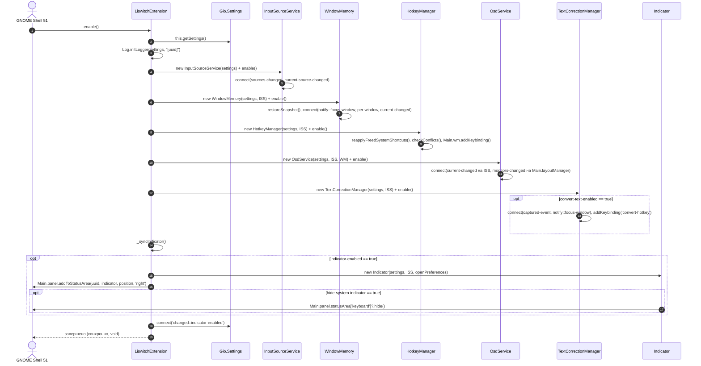
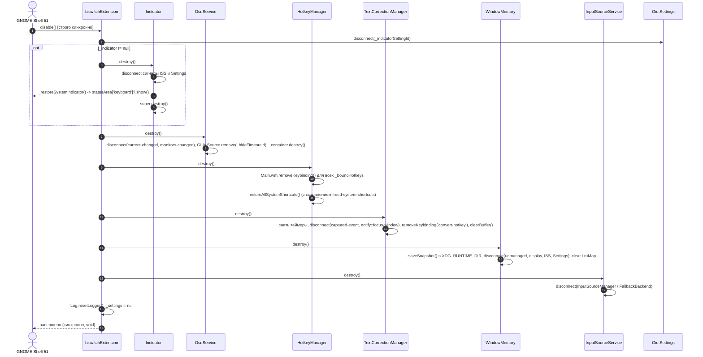

# Архитектура расширения liswitch

- **Идентификатор расширения (UUID)**: `liswitch@local`
- **Целевая платформа**: GNOME Shell 51 (GJS 1.90, Mutter 51, только сессия Wayland)
- **Версия документа**: 2.0 (актуализация под текущую реализацию, Шаг 2.5)
- **Статус**: Актуальна

---

## 1. Дерево файлов проекта

Проект организован по модульному принципу в виде стандартных ES-модулей (ESM) без монолитного файла `extension.js`:

```
liswitch/
├── metadata.json                        # Манифест расширения (UUID, shell-version: ["51"], gettext-domain, session-modes)
├── extension.js                         # Главный класс LiswitchExtension: точка входа, координация enable/disable
├── prefs.js                             # Класс LiswitchPreferences (ExtensionPreferences): UI на Libadwaita (5 вкладок)
├── stylesheet.css                       # Стили для OSD-уведомления и индикатора верхней панели
├── Makefile                             # Сборка схем, переводов, линтинг, юнит-тесты, упаковка zip
├── eslint.config.js                     # Конфигурация ESLint (flat config) для ESM / GJS
├── README.md                            # Описание, установка, настройка, архитектура
├── CHANGELOG.md                         # История изменений релизов
├── LICENSE                              # Текст лицензии GPL-2.0-or-later
├── schemas/
│   └── org.gnome.shell.extensions.liswitch.gschema.xml  # Схема GSettings с описанием всех параметров
├── src/
│   ├── log.js                           # Единый логгер расширения (debug/info/warn/error, привязка к ключу debug)
│   ├── inputSourceService.js            # InputSourceService и FallbackBackend (обёртка над InputSourceManager)
│   ├── windowMemory.js                  # WindowMemory, LruMap, ключи окон/приложений, runtime snapshot в XDG_RUNTIME_DIR
│   ├── hotkeys.js                       # HotkeyManager и утилиты обнаружения/освобождения конфликтов клавиш
│   ├── indicator.js                     # Indicator (PanelMenu.Button), форматирование метки и A11y-подписи
│   ├── osd.js                           # OsdService: кастомный оверлей St.Widget на Main.uiGroup
│   ├── textCorrection.js                # TextCorrectionManager (F6): буфер ввода в RAM, двойной Shift, замена слова
│   └── textTranslator.js                # TextTranslator (F6): парсер XKB symbols + фолбэк-карты US/RU/KZ
├── po/
│   ├── liswitch.pot                     # Шаблон локализации gettext
│   ├── ru.po                            # Русский перевод
│   └── kk.po                            # Казахский перевод
├── scripts/
│   ├── dev-run.sh                       # Вспомогательный сценарий разработки, сборки и локального запуска тестов
│   ├── generate-po.py                   # Генератор обновлений po/ru.po и po/kk.po из po/liswitch.pot
│   └── release.sh                       # Сценарий проверки и подготовки релизного архива
├── tests/
│   ├── helpers.js                       # Общие ассерты и мок-объекты (MockSettings, MockInputSourceManager и др.)
│   ├── smoke-test.js                    # Headless-тест для gnome-shell-test-tool (100 циклов enable/disable)
│   ├── test-input-source-service.js     # Юнит-тесты InputSourceService и FallbackBackend
│   ├── test-indicator.js                # Юнит-тесты Indicator, форматов, прокрутки, меню и sync системного индикатора
│   ├── test-hotkeys.js                  # Юнит-тесты HotkeyManager и разрешения конфликтов
│   ├── test-window-memory.js            # Юнит-тесты WindowMemory, LruMap и runtime snapshot
│   ├── test-osd.js                      # Юнит-тесты OsdService, таймеров, monitors-changed и ReducedMotion
│   ├── test-prefs.js                    # Юнит-тесты helpers окна настроек и SignalTracker
│   ├── test-text-correction.js          # Юнит-тесты TextCorrectionManager и TextTranslator
│   ├── test-performance.js              # Бенчмарк задержки обработчика смены фокуса
│   ├── test-stress-100-cycles.js        # Нагрузочный тест 100 циклов enable/disable полного стека сервисов
│   └── test-resilience.js               # Тест 7 сценариев устойчивости (hotplug раскладок/мониторов, блокировка и др.)
└── docs/
    ├── PROGRESS.md                      # Долгосрочный журнал этапов разработки
    ├── api-notes.md                     # Аудированный справочник по API GNOME Shell 51
    ├── spec.md                          # Спецификация функциональности
    ├── audit.md                         # Отчёт о полном аудите качества
    └── architecture.md                  # Настоящий архитектурный документ
```

---

## 2. Схема GSettings (`schemas/org.gnome.shell.extensions.liswitch.gschema.xml`)

Расширение использует выделенный путь настроек `/org/gnome/shell/extensions/liswitch/` и домен локализации `liswitch`:

```xml
<?xml version="1.0" encoding="UTF-8"?>
<schemalist gettext-domain="liswitch">
  <schema id="org.gnome.shell.extensions.liswitch" path="/org/gnome/shell/extensions/liswitch/">

    <key name="debug" type="b">
      <default>false</default>
      <summary>Enable debug logging</summary>
      <description>Whether to print verbose debug messages to the system log.</description>
    </key>

    <!-- === Индикатор панели === -->
    <key name="indicator-enabled" type="b">
      <default>true</default>
      <summary>Show indicator in top panel</summary>
      <description>Whether to show the language indicator button in the GNOME Shell top panel.</description>
    </key>

    <key name="hide-system-indicator" type="b">
      <default>false</default>
      <summary>Hide default system keyboard indicator</summary>
      <description>Whether to hide the default GNOME Shell keyboard indicator to prevent duplicates.</description>
    </key>

    <key name="indicator-format" type="s">
      <default>'short'</default>
      <summary>Format of the layout text in the panel</summary>
      <description>Display format for the current layout code: 'short' (uppercase code, e.g. EN, RU), 'lowercase' (en, ru), 'full' (displayName, e.g. English (US), Russian).</description>
    </key>

    <key name="scroll-switch" type="b">
      <default>true</default>
      <summary>Switch layout with mouse scroll</summary>
      <description>Whether scrolling the mouse wheel over the indicator switches to next/previous layout.</description>
    </key>

    <!-- === Память раскладок для окон/приложений === -->
    <key name="memory-mode" type="s">
      <choices>
        <choice value="off"/>
        <choice value="per-app"/>
        <choice value="per-window"/>
      </choices>
      <default>'per-app'</default>
      <summary>Layout memory persistence mode</summary>
      <description>Mode of remembering layouts: 'off' (disabled), 'per-app' (per application), 'per-window' (per individual window).</description>
    </key>

    <key name="default-layout-mode" type="s">
      <choices>
        <choice value="keep"/>
        <choice value="first"/>
      </choices>
      <default>'keep'</default>
      <summary>Default layout for new windows</summary>
      <description>Action for newly focused windows without prior history: 'keep' (preserve active layout), 'first' (reset to first configured layout).</description>
    </key>

    <key name="memory-excluded-apps" type="as">
      <default>[]</default>
      <summary>List of applications excluded from layout memory</summary>
      <description>Array of application IDs or WM_CLASS values that should be ignored by the memory manager.</description>
    </key>

    <!-- === Экранное OSD-уведомление === -->
    <key name="show-osd" type="b">
      <default>true</default>
      <summary>Show OSD pop-up on layout switch</summary>
      <description>Display a brief centered on-screen display when switching input sources.</description>
    </key>

    <key name="osd-duration-ms" type="u">
      <range min="300" max="3000"/>
      <default>1000</default>
      <summary>OSD display duration in milliseconds</summary>
      <description>How long the OSD pop-up stays visible before fading out.</description>
    </key>

    <key name="osd-show-on-auto-switch" type="b">
      <default>false</default>
      <summary>Show OSD on automatic window layout restore</summary>
      <description>Whether to show OSD notification when layout is restored automatically for a window.</description>
    </key>

    <!-- === Горячие клавиши === -->
    <key name="hotkey-next" type="as">
      <default><![CDATA[['<Control><Alt>space']]]></default>
      <summary>Switch to next input source</summary>
      <description>Keybinding to activate the next configured input source cyclically.</description>
    </key>

    <key name="hotkey-previous" type="as">
      <default><![CDATA[['<Control><Alt><Shift>space']]]></default>
      <summary>Switch to previous input source</summary>
      <description>Keybinding to activate the previous configured input source cyclically.</description>
    </key>

    <key name="hotkey-switch-1" type="as">
      <default>[]</default>
      <summary>Direct switch to input source 1</summary>
      <description>Keybinding to directly activate the 1st configured layout (index 0).</description>
    </key>

    <key name="hotkey-switch-2" type="as">
      <default>[]</default>
      <summary>Direct switch to input source 2</summary>
      <description>Keybinding to directly activate the 2nd configured layout (index 1).</description>
    </key>

    <key name="hotkey-switch-3" type="as">
      <default>[]</default>
      <summary>Direct switch to input source 3</summary>
      <description>Keybinding to directly activate the 3rd configured layout (index 2).</description>
    </key>

    <key name="hotkey-switch-4" type="as">
      <default>[]</default>
      <summary>Direct switch to input source 4</summary>
      <description>Keybinding to directly activate the 4th configured layout (index 3).</description>
    </key>

    <!-- === Резервные копии освобождённых системных клавиш === -->
    <key name="backup-system-shortcuts" type="s">
      <default>"{}"</default>
      <summary>Backup map of freed system shortcuts</summary>
      <description>JSON-encoded dictionary of original system keybindings modified by user action.</description>
    </key>

    <key name="backup-system-switch-keys" type="as">
      <default>[]</default>
      <summary>Backup of system switch-input-source</summary>
      <description>Saved original values of switch-input-source for rollback upon extension disable.</description>
    </key>

    <key name="backup-system-switch-backward-keys" type="as">
      <default>[]</default>
      <summary>Backup of system switch-input-source-backward</summary>
      <description>Saved original values of switch-input-source-backward for rollback upon extension disable.</description>
    </key>

    <key name="freed-system-shortcuts" type="s">
      <default>"{}"</default>
      <summary>User-approved system shortcut overrides</summary>
      <description>JSON-encoded dictionary of system shortcuts explicitly freed by user action, preserved across temporary disables such as screen lock.</description>
    </key>

    <!-- === Исправление текста (F6) === -->
    <key name="convert-text-enabled" type="b">
      <default>false</default>
      <summary>Enable wrong layout text conversion</summary>
      <description>Whether to enable in-memory keyboard buffer to convert text typed in the wrong layout (e.g. ghbdtn -> привет).</description>
    </key>

    <key name="convert-double-shift" type="b">
      <default>true</default>
      <summary>Trigger conversion on double Left Shift</summary>
      <description>Convert the last typed word when Left Shift is pressed twice in quick succession.</description>
    </key>

    <key name="convert-hotkey" type="as">
      <default><![CDATA[['<Shift>Pause']]]></default>
      <summary>Shortcut to convert last typed word</summary>
      <description>Keybinding to trigger layout conversion of the most recently typed word.</description>
    </key>

  </schema>
</schemalist>
```

---

## 3. Жизненный цикл расширения (`enable` / `disable`)

### 3.1. Требование строгой синхронности
В GNOME Shell 51 метод `disable()` проверяется загрузчиком расширений `ExtensionSystem`. Если метод возвращает `Promise` (объявлен через `async` или возвращает thenable-объект), выбрасывается неперехватываемое исключение:
`Error: disable() must not be async`.
Все сервисы `liswitch` проектируются строго синхронными: создание и освобождение ресурсов происходят в один проход без ожидания промисов. В конструкторах сервисов выполняется минимальная инициализация полей; подключение сигналов и системных обработчиков происходит в методе `enable()` (для `Indicator` — в `_init()` при добавлении на панель через `_syncIndicator()`).

### 3.2. Диаграмма последовательности инициализации (`enable`)



### 3.3. Диаграмма последовательности деактивации (`disable`)

Очистка выполняется строго в обратном порядке (LIFO) для предотвращения гонок и обращений к уничтоженным зависимостям:



---

## 4. Модули, их границы и публичные интерфейсы

### 4.1. `Log` (`src/log.js`)
Единый модуль логирования для всех компонентов Shell-части расширения.

- **Функции**:
  - `initLogger(settings, prefix)` — сохраняет ссылку на `Gio.Settings` (ключ `debug`) и префикс вида `[liswitch@local]`.
  - `resetLogger()` — сбрасывает `_settings = null` и `_debugOverride = null` при `disable()`.
  - `setDebugOverride(enabled)` — программное переопределение флага отладки для тестов.
  - `isDebugEnabled(): boolean`
  - `debug(...args)`, `info(...args)`, `warn(...args)`, `error(...args)` — `debug()` пишет в `console.log` только при включённом `debug`.

### 4.2. `InputSourceService` и `FallbackBackend` (`src/inputSourceService.js`)
Изолирует взаимодействие с системным `InputSourceManager` (`resource:///org/gnome/shell/ui/status/keyboard.js`). При недоступности `getInputSourceManager()` (например, в standalone-тестах или при сбое инициализации клавиатурного менеджера) автоматически активируется `FallbackBackend` поверх `org.gnome.desktop.input-sources`.

- **Зависимости**: `Gio.Settings` (схема `liswitch`).
- **Свойства**:
  - `isAvailable: boolean` — доступность сервиса и наличие хотя бы одной раскладки.
  - `state: 'available' | 'unavailable'`.
- **Публичные методы**:
  - `enable({manager = null} = {}): void` — подключение к `InputSourceManager` (или `FallbackBackend`) и первичная синхронизация.
  - `destroy(): void` — отписка от всех сигналов, разрушение `FallbackBackend`, сброс состояния.
  - `getSources(): Array<{index, id, shortName, displayName}>` — массив раскладок, отсортированный по `index`.
  - `getCurrentIndex(): number` — индекс активной раскладки или `-1`.
  - `getCurrentSource(): {index, id, shortName, displayName} | null` — текущая активная раскладка.
  - `activate(index: number, interactive = true): boolean` — переключение по индексу (`source.activate(interactive)` или `manager.activateInputSource(source, interactive)`).
  - `next(): boolean` / `previous(): boolean` — циклическое переключение вперёд/назад в интерактивном режиме (`interactive = true`).
- **Сигналы `GObject.Object`**:
  - `'sources-changed' ()` — изменение списка доступных раскладок.
  - `'current-changed' (index: number)` — смена активной раскладки.

### 4.3. `WindowMemory` (`src/windowMemory.js`, алиас `WindowMemoryService`)
Отвечает за запоминание и тихое восстановление раскладок для приложений и отдельных окон, включая хранение краткоживущего runtime-снимка в `tmpfs` (`$XDG_RUNTIME_DIR/liswitch/window-memory.json`) для переживания временных циклов `disable()`/`enable()` (например, блокировки экрана).

- **Зависимости**: `Gio.Settings`, `InputSourceService`.
- **Структуры данных и константы**:
  - `MAX_MEMORY_ENTRIES = 500`, `SNAPSHOT_TTL_MS = 24 * 60 * 60 * 1000`.
  - `LruMap` — LRU-кэш фиксированной ёмкости: `_appMemory` и `_windowMemory`.
  - `_trackedWindows: Map<Meta.Window, number>` — активные подписки на `'unmanaged'`.
  - `_systemPerWindowActive: boolean` — отслеживание системного флага `org.gnome.desktop.input-sources per-window` (при его включении память `liswitch` автоматически приостанавливается во избежание двойного переключения).
- **Вспомогательные функции**:
  - `getAppKey(window)` — приоритет: `get_sandboxed_app_id()` → `get_gtk_application_id()` → `get_wm_class()`.
  - `getWindowKey(window)` — `String(window.get_id())`.
  - `isWindowExcluded(window, excludedList)` — проверка по `sandboxed_app_id`, `gtk_application_id`, `wm_class`, `wm_class_instance` без учёта регистра.
- **Публичные методы и геттеры**:
  - `enable({display = null, desktopSettings = null} = {}): void`
  - `destroy(): void` — сохраняет текущую раскладку и snapshot (если `memory-mode !== 'off'` и системный `per-window` выключен), отключает все сигналы (`unmanaged`, `global.display`, `desktopSettings`, `InputSourceService`, `settings`) и очищает `LruMap`.
  - `clearMemory(): void` — очищает кэши в RAM и удаляет snapshot-файл.
  - `getSavedAppLayout(appKey)`, `getSavedWindowLayout(windowKey)`
  - Геттеры: `memoryMode` (`'off' | 'per-app' | 'per-window'`), `defaultLayoutMode` (`'keep' | 'first'`), `excludedApps`, `isSystemPerWindowActive`, `currentWindow`, `appMemorySize`, `windowMemorySize`, `isRestoring`.
- **Логика восстановления**:
  - При `notify::focus-window`: сохраняет раскладку уходящего окна (если оно не в `memory-excluded-apps`), при `focus_window === null` (Overview, панель, экран блокировки) сохраняет текущее состояние без переключений.
  - Для нового окна ищет сохранённую раскладку (по `id`, с фолбэком на `index` или `sources[0]`) и вызывает `inputSourceService.activate(targetIndex, false)` под флагом `_isRestoring = true` (тихая смена без искажения системного порядка MRU).

### 4.4. `HotkeyManager` (`src/hotkeys.js`)
Управляет регистрацией сочетаний клавиш в оконном менеджере Mutter и разрешением конфликтов с системными привязками GNOME.

- **Зависимости**: `Gio.Settings`, `InputSourceService`.
- **Поддерживаемые ключи**: `HOTKEY_KEYS` = `['hotkey-next', 'hotkey-previous', 'hotkey-switch-1', 'hotkey-switch-2', 'hotkey-switch-3', 'hotkey-switch-4', 'convert-hotkey']` (`HotkeyManager` регистрирует первые 6; `convert-hotkey` регистрируется `TextCorrectionManager`).
- **Режимы и флаги регистрации**:
  - `ActionMode.NORMAL | ActionMode.OVERVIEW` (`Shell.ActionMode`), `KeyBindingFlags.NONE` (`Meta.KeyBindingFlags`).
  - Автоматическая динамическая перерегистрация при изменении любого ключа `changed::hotkey-*` или `changed::freed-system-shortcuts`.
- **Управление конфликтами с системными клавишами**:
  - В отличие от старого подхода с единым флагом, пользователь освобождает конкретный конфликтующий шорткат в окне настроек (`prefs.js`):
  - `checkConflicts(settings)` — сканирует `org.gnome.desktop.wm.keybindings` и `org.gnome.settings-daemon.plugins.media-keys`.
  - `freeSystemShortcut(conflict, settings)` — сохраняет оригинал в `backup-system-shortcuts` (и при необходимости в `backup-system-switch-keys` / `backup-system-switch-backward-keys`), записывает намерение пользователя в `freed-system-shortcuts` и удаляет конфликтующий акселератор из системной схемы.
  - `restoreSystemShortcut(schemaId, schemaKey, settings)` — восстанавливает системный ключ из бэкапа и удаляет запись из `freed-system-shortcuts`.
  - `restoreAllSystemShortcuts(settings, {clearIntent = false})` — вызывается в `HotkeyManager.destroy()` для отката системных ключей на время отключения расширения; при `clearIntent = false` сохраняет `freed-system-shortcuts`, чтобы `reapplyFreedSystemShortcuts()` в `enable()` автоматически восстановил выбор пользователя после разблокировки экрана.
  - `cleanupUnusedSystemOverrides(settings)` — удаляет устаревшие переопределения, если шорткат больше не используется в `liswitch`.
  - Утилиты валидации: `normalizeShortcut()`, `isModifierOnlyShortcut()`, `findDuplicateHotkeyKey()`.
- **Публичные методы**:
  - `enable(): void`, `destroy(): void`, геттер `boundHotkeys: Set<string>`.

### 4.5. `Indicator` (`src/indicator.js`)
Кнопка в правой части верхней панели GNOME Shell (`PanelMenu.Button` внутри Shell, `GObject.Object` в standalone-тестах), отображающая текущую раскладку и предоставляющая меню выбора.

- **Зависимости**: `Gio.Settings`, `InputSourceService`, колбэк `openPreferences`.
- **Регистрация в панели**: `Main.panel.addToStatusArea(this.uuid, this._indicator, position, 'right')` (позиционируется рядом с системным `'keyboard'`; управляется ключом `indicator-enabled`).
- **Внутренние элементы**:
  - `St.Label` (класс `liswitch-indicator-label`, формат `'short' | 'lowercase' | 'full'` по ключу `indicator-format`).
  - `PopupMenu` со списком всех раскладок (`PopupMenu.Ornament.DOT` / `NO_DOT`), разделителем и пунктом `Settings…` (или заглушкой `No layouts configured` при 0 раскладках).
  - Доступность: `Atk.Role.MENU` и динамический `accessible_name` (`getAccessibleLayoutLabel()`).
- **Поведение**:
  - Прокрутка колесом мыши (`scroll-event` -> `handleScroll(event)`): переключение `next()`/`previous()` при `scroll-switch = true` (с дебаунсом 150 мс для плавной прокрутки `Clutter.ScrollDirection.SMOOTH`).
  - Управление системным индикатором `statusArea['keyboard']`: при `hide-system-indicator = true` скрывает системный индикатор на старте, при изменении настройки и повторно при `sources-changed` (так как системный индикатор GNOME Shell способен самостоятельно вызывать `show()` при изменении списка раскладок). В `_onDestroy()` системный индикатор гарантированно восстанавливается (`_restoreSystemIndicator()`).
- **Публичные методы и геттеры**: `handleScroll(event)`, `destroy()`, `label`, `menuItems`, экспортированные функции `formatLayoutLabel()`, `getAccessibleLayoutLabel()`.

### 4.6. `OsdService` (`src/osd.js`)
Предоставляет центрированный экранный оверлей при смене раскладки. Не использует `Main.osdWindowManager` из-за жёсткого `HIDE_TIMEOUT = 1500ms`, нижнего выравнивания и отсутствия контроля отмены таймеров и `St.ReducedMotion`.

- **Зависимости**: `Gio.Settings`, `InputSourceService`, `WindowMemory`.
- **Внутреннее состояние**:
  - `_container: St.Widget | null` на `Main.uiGroup` с `Layout.MonitorConstraint` (центрируется на мониторе активного окна `focus_window.get_monitor()`, либо на `primaryIndex`).
  - `_hideTimeoutId: number` (`GLib.timeout_add` на время `osd-duration-ms`).
  - Подписка на `current-changed` у `InputSourceService` (игнорирует события при `windowMemory.isRestoring === true`, если `osd-show-on-auto-switch === false`).
  - Подписка на `monitors-changed` у `Main.layoutManager`: если при изменении конфигурации мониторов OSD открыт, пересчитывает индекс целевого монитора через `_updateMonitorConstraint()` (или безопасно скрывает OSD через `hide()`, если число мониторов временно равно 0).
- **Публичные методы и геттеры**:
  - `enable(options = {}): void`, `show(source): void`, `hide(): void`, `destroy(): void`.
  - Геттеры: `isEnabled` (читает только ключ `show-osd`), `duration` (`osd-duration-ms`), `showOnAutoSwitch` (`osd-show-on-auto-switch`), `container`, `lastShownSource`, `isShowing`.
- **Доступность**: проверка `St.Settings.get().reduced_motion === St.ReducedMotion.REDUCE` — при активном флаге переходы `ease()` отключаются, показ и скрытие происходят мгновенно.

### 4.7. `TextCorrectionManager` (`src/textCorrection.js`) и `TextTranslator` (`src/textTranslator.js`) — функция F6
Конвертирует последнее ошибочно набранное слово (например, `ghbdtn` → `привет`) и переключает раскладку на целевую. По умолчанию отключена (`convert-text-enabled = false`).

- **`TextCorrectionManager`**:
  - Перехватывает события клавиатуры/мыши через `global.stage.connect('captured-event', ...)` только пока `convert-text-enabled = true`.
  - Хранит буфер набранных символов строго в RAM (`_buffer`, лимит 64 символа).
  - Автоматически сбрасывает буфер при: смене окна (`notify::focus-window`), кликах мыши/касаниях, модификаторах (`Ctrl`/`Alt`/`Super`/`Meta`), командных клавишах (`Esc`, `Enter`, `Tab`), навигационных клавишах (`Left`/`Right`/`Up`/`Down`/`Home`/`End`/`PageUp`/`PageDown`/`Delete`/`Insert`), пробелах, таймере неактивности (3 секунды) и в чувствительных окнах (детектор по `SENSITIVE_PATTERNS` в `wm_class`, `title`, `sandboxed_app_id`).
  - Триггеры вызова `convertLastWord()`: двойное нажатие `Left Shift` (`convert-double-shift`, окно 50–400 мс) или горячая клавиша `convert-hotkey` (`Main.wm.addKeybinding`, `Shell.ActionMode.NORMAL`, `Meta.KeyBindingFlags.IGNORE_AUTOREPEAT`).
  - Замена текста: при помощи `TextTranslator` подбирает наилучшую целевую раскладку, сохраняет текущий текст системного буфера обмена, отправляет серию `Backspace` через `Clutter.VirtualInputDevice`, записывает сконвертированный текст в `St.Clipboard`, через 20 мс эмулирует `Ctrl+V`, через 100 мс восстанавливает исходное содержимое буфера обмена и активирует целевую раскладку.
  - В `destroy()` снимает все 4 возможных таймера (`_inactivityTimerId`, `_clipboardReadTimeoutId`, `_pasteTimeoutId`, `_restoreClipboardTimeoutId`), отключает `captured-event`, `notify::focus-window`, снимает `convert-hotkey` и очищает буфер/кэш.
- **`TextTranslator`**:
  - Парсит файлы `/usr/share/X11/xkb/symbols/<layout>` (поддерживает `include`/`override`/`augment`/`replace` и многострочные определения клавиш) с использованием `Clutter.keysym_to_unicode()`.
  - Имеет встроенные фолбэк-таблицы `FALLBACK_US`, `FALLBACK_RU`, `FALLBACK_KZ` для сред без доступа к XKB или без `Clutter`.
  - Методы: `resolveLayout(layoutId)`, `convert(text, fromLayoutId, toLayoutId)`, `guessSourceLayout(text, layoutA, layoutB)`, `clearCache()`.

---

## 5. Таблица владения ресурсами («Ресурс → кто создаёт → кто уничтожает»)

Строгое соблюдение правила отсутствия утечек памяти: каждый выделенный ресурс имеет одного владельца и точку безусловного синхронного уничтожения.

| Ресурс / Подписка | Создатель / Владелец | Момент создания | Точка и метод очистки | Гарантия очистки |
|---|---|---|---|---|
| `this._settings` и подписка `changed::indicator-enabled` | `LiswitchExtension` | `enable()` | `disable()` (`disconnect()`, `this._settings = null`) | `Extension.disable()` |
| Логгер `Log` | `LiswitchExtension` | `enable()` (`Log.initLogger()`) | `disable()` (`Log.resetLogger()`) | `Extension.disable()` |
| Подписки `sources-changed`, `current-source-changed` на `InputSourceManager` | `InputSourceService` | `enable()` | `InputSourceService.destroy()` (`obj.disconnect(id)`) | `Extension.disable()` |
| Подписки `changed::sources`, `changed::current` на `org.gnome.desktop.input-sources` | `FallbackBackend` | `FallbackBackend.enable()` | `FallbackBackend.destroy()` (`_desktopSettings.disconnect(id)`) | При разрушении `InputSourceService` |
| Подписка `notify::focus-window` на `global.display` | `WindowMemory` | `WindowMemory.enable()` | `WindowMemory.destroy()` (`_display.disconnect()`) | `Extension.disable()` |
| Подписка `changed::per-window` на `org.gnome.desktop.input-sources` | `WindowMemory` | `WindowMemory.enable()` | `WindowMemory.destroy()` (`_desktopSettings.disconnect()`) | `Extension.disable()` |
| Подписки `unmanaged` на объектах `Meta.Window` | `WindowMemory` | `_trackWindow(window)` при фокусе | `_onWindowUnmanaged()` и цикл в `WindowMemory.destroy()` | Закрытие окна + `disable()` |
| Кэши в RAM `_appMemory`, `_windowMemory` (`LruMap`) и snapshot в `XDG_RUNTIME_DIR` | `WindowMemory` | По мере работы / `destroy()` | `WindowMemory.destroy()` (`clear()`) / `clearMemory()` (удаление файла) | ОЗУ очищается в `disable()`, tmpfs очищается ОС при logout |
| Привязки клавиш `Main.wm.addKeybinding` (`hotkey-next/previous/switch-1..4`) | `HotkeyManager` | `HotkeyManager.enable()` / `_bindKey()` | `HotkeyManager.destroy()` (`Main.wm.removeKeybinding()`) | `Extension.disable()` |
| Системные привязки, освобождённые пользователем (`backup-system-shortcuts`) | `HotkeyManager` | `freeSystemShortcut()` из `prefs.js` | `HotkeyManager.destroy()` -> `restoreAllSystemShortcuts()` | Восстановление на время `disable()` |
| Кнопка панели `Indicator` (`PanelMenu.Button`, роль `this.uuid`) | `LiswitchExtension` | `_syncIndicator()` | `_syncIndicator()` / `disable()` -> `Indicator.destroy()` | Удаление из `Main.panel.statusArea` |
| Сокрытие системного индикатора `'keyboard'` | `Indicator` | `_syncSystemIndicator()` (при старте, смене настройки и `sources-changed`) | `_onDestroy()` -> `_restoreSystemIndicator()` (`statusArea['keyboard']?.show()`) | Восстановление при `disable()` или выключении индикатора |
| Подписки `current-changed` (ISS) и `monitors-changed` (`Main.layoutManager`) | `OsdService` | `OsdService.enable()` | `OsdService.destroy()` (`disconnect()` обоих сигналов) | `Extension.disable()` |
| Таймер скрытия OSD (`_hideTimeoutId`) и виджеты на `Main.uiGroup` | `OsdService` | `OsdService.show()` | `_hide()` и `OsdService.destroy()` (`GLib.Source.remove()`, `_container.destroy()`) | `Extension.disable()` |
| Перехват `captured-event` (`global.stage`), `notify::focus-window` (`global.display`), `convert-hotkey` (`Main.wm`) | `TextCorrectionManager` | `_startTracking()` / `_rebindHotkey()` | `_stopTracking()`, `_unbindHotkey()`, `TextCorrectionManager.destroy()` | `Extension.disable()` или выключение `convert-text-enabled` |
| Таймеры вставки/буфера (`_inactivityTimerId`, `_clipboardReadTimeoutId`, `_pasteTimeoutId`, `_restoreClipboardTimeoutId`) | `TextCorrectionManager` | `_resetInactivityTimer()` / `convertLastWord()` | `_clearPasteTimers()`, `_stopTracking()`, `TextCorrectionManager.destroy()` | `GLib.Source.remove()` во всех путях остановки |
| Кэши XKB (`_fileCache`, `_layoutCache`, `_reverseCache`) | `TextTranslator` | `resolveLayout()` | `TextTranslator.clearCache()` в `TextCorrectionManager.destroy()` | `Extension.disable()` |

---

## 6. Обработка ошибок и непредвиденных состояний

1. **Недоступность `getInputSourceManager()`**:
   - *Ситуация*: Нестандартная сессия или сбой инициализации клавиатурного менеджера Shell.
   - *Реакция*: Перехват в `try...catch`. `InputSourceService` автоматически переходит на `FallbackBackend` (`org.gnome.desktop.input-sources`), чтобы остальные модули могли безопасно читать список источников или корректно переходить в состояние `'unavailable'` без падения Shell.
2. **Список раскладок пуст (`sources` пуст)**:
   - *Ситуация*: В системе не настроено ни одного источника ввода.
   - *Реакция*:
     - `InputSourceService.isAvailable === false`, `getCurrentIndex() === -1`, `getSources() === []`.
     - `Indicator` отображает `--` и неактивный пункт меню `_('No layouts configured')`.
     - `next()`, `previous()`, `activate()`, `TextCorrectionManager.convertLastWord()` безопасно возвращают `false` (no-op).
3. **Динамическое изменение набора раскладок во время работы (`sources-changed`)**:
   - *Ситуация*: Пользователь добавил или удалил раскладку в настройках GNOME.
   - *Реакция*:
     - `InputSourceService` пересинхронизирует массив источников и корректирует `currentIndex`, если текущий источник исчез.
     - `Indicator` обновляет метку, перестраивает меню и повторно вызывает `_syncSystemIndicator()` (так как системный индикатор `'keyboard'` может показать себя сам при `sources-changed`).
     - `WindowMemory` при следующем фокусе не найденную по `id` раскладку безопасно переводит на `sources[0]`.
4. **Смена фокуса на системные модальные интерфейсы (`focus_window === null`)**:
   - *Ситуация*: Открыт Overview, системный диалог, панель или экран блокировки.
   - *Реакция*: `WindowMemory` фиксирует уходящее окно, обновляет `_currentWindow = null` и не выполняет переключений раскладки. `TextCorrectionManager` очищает буфер набранных символов.
5. **Подключение и отключение мониторов (`monitors-changed`)**:
   - *Ситуация*: Внешний монитор отключён или переподключён в момент показа OSD (или при активном расширении).
   - *Реакция*: `OsdService` получает сигнал `monitors-changed` от `Main.layoutManager`. Если число мониторов временно равно 0, открытый OSD немедленно скрывается (`hide()`). Иначе пересчитывается индекс целевого монитора (`_updateMonitorConstraint()`) в пределах доступных мониторов.
6. **Конфликт с системным `org.gnome.desktop.input-sources per-window`**:
   - *Ситуация*: У пользователя включена встроенная память окон GNOME.
   - *Реакция*: `WindowMemory` автоматически приостанавливает собственное переключение (предупреждение в логах + информационный баннер с кнопкой отключения в `prefs.js` на вкладке Memory), не модифицируя системную настройку без согласия пользователя.

---

## 7. Политика поведения на экране блокировки (`unlock-dialog`)

### Решение
В файле `metadata.json` режим сессии объявляется строго по умолчанию:
```json
"session-modes": ["user"]
```
Режим `unlock-dialog` **НЕ ЗАЯВЛЯЕТСЯ**.

### Обоснование решения
1. **Безопасность PAM и экрана блокировки**:
   Экран блокировки — критический рубеж безопасности. Сторонний код и глобальные перехватчики событий (`captured-event`) не должны работать поверх экрана ввода пароля.
2. **Встроенный функционал GNOME Shell**:
   В режиме `unlock-dialog` GNOME Shell использует собственный изолированный индикатор клавиатуры.
3. **Автоматический жизненный цикл и бесшовное восстановление**:
   При блокировке экрана GNOME Shell синхронно вызывает `disable()`:
   - `HotkeyManager` временно возвращает системные горячие клавиши, сохраняя намерение пользователя в `freed-system-shortcuts`.
   - `WindowMemory` сохраняет актуальный кэш в `tmpfs` (`$XDG_RUNTIME_DIR/liswitch/window-memory.json`).
   При разблокировке Shell вызывает `enable()`: `WindowMemory` мгновенно восстанавливает кэш и раскладку активного окна, а `HotkeyManager` повторно применяет `freed-system-shortcuts`.
4. **Политика модерации extensions.gnome.org**:
   Использование только `["user"]` соответствует требованиям E.G.O Review Guidelines.

---

## 8. Безопасность и приватность данных

| Категория | Что читает / меняет liswitch | Чего liswitch НЕ делает НИКОГДА |
|---|---|---|
| **Ввод пользователя (F2)** | Получает уведомления от зарегистрированных системных шорткатов через Mutter (`Main.wm.addKeybinding`). | **НИКОГДА** не перехватывает ввод для горячих клавиш переключения. |
| **Исправление текста (F6)** | По умолчанию **выключено** (`convert-text-enabled = false`). При включении хранит до 64 последних символов строго в RAM (`_buffer`), очищает буфер при смене окна, кликах, навигации, модификаторах, паузе 3с и в чувствительных окнах (`SENSITIVE_PATTERNS`). Использует `St.Clipboard` только в момент `convertLastWord()` с восстановлением прежнего текста. | **НИКОГДА** не записывает нажатия клавиш на диск, не передаёт их и не выводит в системный журнал (`Log`). |
| **Окна и приложения** | Читает идентификаторы активных окон: `get_sandboxed_app_id()`, `get_gtk_application_id()`, `get_wm_class()`, `get_id()` (и `get_title()` в памяти для эвристики паролей при включённом F6). В `tmpfs` (`$XDG_RUNTIME_DIR/liswitch/window-memory.json`, права каталога `0700`) сохраняет только пары `ключ → {id, index}` со сроком жизни 24ч (очищается при выходе из сессии). | **НИКОГДА** не сохраняет содержимое окон, заголовки документов или пользовательский текст на диск. |
| **Настройки сессии** | Управляет активной раскладкой через `InputSource.activate()`. Временно скрывает системный `'keyboard'` при `hide-system-indicator = true`. Освобождает системные шорткаты только по явному действию пользователя в `prefs.js` с сохранением резервной копии и возвратом при `disable()`. | **НИКОГДА** не перезаписывает системные настройки пользователя без явного подтверждения в UI. |
| **Сеть и процессы** | Полная изоляция внутри процесса GNOME Shell / Prefs: не использует сетевые сокеты, HTTP, DBus-телеметрию или `GLib.spawn*`. | **НИКОГДА** не отправляет телеметрию, не подключает сторонние бинарные зависимости и не запускает внешние процессы. |
